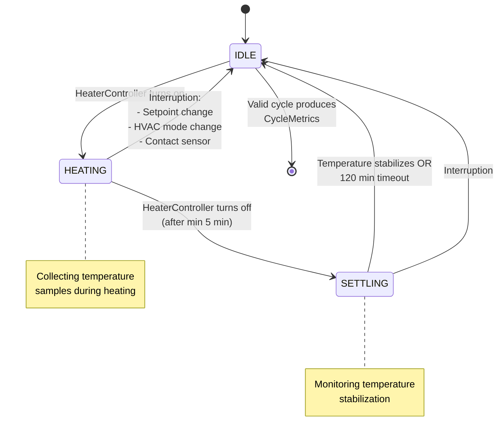

# Adaptive Learning

<!-- pump-aware-fork-preview:start -->
## Fork preview: narrow learning and shared-startup fixes

**Fork preview, not an upstream release feature.** The following information applies to `filou01/ha-adaptive-climate`, branch `codex/pump-aware-pwm`, [preview v0.67.1-pwm.8](https://github.com/filou01/ha-adaptive-climate/releases/tag/v0.67.1-pwm.8). Do not assume the upstream release supports this configuration.

The fork preview contains fixes separate from optional PWM scheduling.
Restored transient cycle flags no longer suppress a fresh learning session;
zero/tiny demand shares one low-demand deadline so small fluctuations cannot
continually cancel settling. Forced OFF closes an active session even when
the electrical output is already OFF. The broader repeated-maintenance case
at or above the existing 2% threshold remains unresolved by these narrow fixes.

PID recommendation diagnostics read actual HEAT gains and distinguish missing
cycles, cooldown and usable data. Viewing a recommendation does not spend
cooldown/cycle credit; successful application does. Learner payload 12 adds
the durable adjustment-cycle counter while retaining prior completed cycles,
gains and confidence. Shared store initialization is serialized before
publication/global number discovery. No manual learning reset is required.

These learning/startup changes remain active when PWM coordination is disabled.
The coordinated-PWM journal is a separate version-1 map in outer Store version
5; it does not replace learner history. See [learning fix scope](https://github.com/filou01/ha-adaptive-climate/blob/codex/pump-aware-pwm/docs/learning-hotfixes.md#english)
and [shared startup](https://github.com/filou01/ha-adaptive-climate/blob/codex/pump-aware-pwm/docs/learning-startup-fix.md#english). No general PID outside-term redesign is implied.
<!-- pump-aware-fork-preview:end -->

The thermostat automatically learns from heating cycles and continuously adjusts PID parameters for optimal performance. This eliminates the need for manual tuning after the initial physics-based initialization.

## What the System Learns

The adaptive learning system tracks multiple thermal characteristics:

| Learning Target | Description | Purpose |
|----------------|-------------|---------|
| **Thermal rates** | Heating and cooling rates (°C/hour) for each zone | Predicts how fast temperature changes |
| **Overshoot patterns** | How much temperature exceeds setpoint | Reduces temperature swings |
| **Settling behavior** | Time to stabilize and oscillation patterns | Improves comfort and efficiency |
| **Ke Learning** | Physics-based init, then fine-tuned after PID converges (3 cycles + 5 observations) | Reduces PID workload |
| **Wind impact** | Wind speed effect on heat loss via Ke_wind | Compensates for wind-driven heat loss |

## Cycle Tracking State Machine

The `CycleTrackerManager` implements a three-state machine for real-time learning:

1. **IDLE**: No heating active, waiting for heater to turn on
2. **HEATING**: Heater active, collecting temperature samples
3. **SETTLING**: Heater off, monitoring temperature stabilization



### State Transitions

- **IDLE → HEATING**: When `HeaterController` turns on heater
- **HEATING → SETTLING**: When `HeaterController` turns off heater (after min 5 min)
- **SETTLING → IDLE**: When temperature stabilizes OR 120 min timeout

### Valid Cycle Output

Valid cycles produce `CycleMetrics` (with `interruption_history` for debugging) fed to `AdaptiveLearner` for PID tuning recommendations. Minimum **6 cycles required** (`MIN_CYCLES_FOR_LEARNING = 6`) before adaptive recommendations are generated, increased from 3 to improve outlier detection.

## Interruption Decision Matrix

Setpoint changes, HVAC mode changes, or contact sensor triggers may invalidate the current cycle. The `InterruptionClassifier` in `adaptive/cycle_analysis.py` provides standardized interruption handling:

| Interruption Type | Classification Logic | Action | Rationale |
|-------------------|---------------------|---------|-----------|
| **Setpoint Change (Major)** | ΔT > 0.5°C AND device inactive | **Abort cycle** | Large setpoint change when heater off indicates user intent change - cycle data no longer valid |
| **Setpoint Change (Minor)** | ΔT ≤ 0.5°C OR device active | **Continue tracking** | Small adjustments or changes during active heating - update target and continue |
| **Mode Change** | Incompatible mode transition | **Abort cycle** | heat→off, cool→heat, etc. terminate control - cycle invalid |
| **Mode Change (Compatible)** | heat→auto, cool→auto, etc. | **Continue tracking** | Compatible mode changes preserve control objective |
| **Contact Sensor** | Open > 300s (5 min) | **Abort cycle** | Extended window/door opening invalidates thermal model |
| **Contact Sensor (Grace)** | Open ≤ 300s | **No interruption** | Brief openings (checking mail, etc.) - cycle continues |
| **Settling Timeout** | 120 min without stabilization | **Finalize cycle** | Prevents infinite settling wait - record what we have |

**Constants:**
- `SETPOINT_MAJOR_THRESHOLD = 0.5°C` - threshold for major vs minor setpoint changes
- `CONTACT_GRACE_PERIOD = 300s` - grace period for brief contact sensor openings

## PID Adjustment Rules

The adaptive learner applies rule-based adjustments based on observed cycle metrics using a priority-based conflict resolution system. All adjustments are scaled by a learning rate multiplier based on convergence confidence.

### Rule System

Rules are evaluated with priorities:
- **Priority 3 (highest)**: Oscillation rules (safety)
- **Priority 2**: Overshoot rules (stability)
- **Priority 1 (lowest)**: Response time rules (performance)

When rules conflict, the higher priority rule wins. Rules use hysteresis (20% band) to prevent rapid activation/deactivation.

### Adjustment Rules

| Observation | Adjustment | Notes |
|-------------|------------|-------|
| High overshoot (>1.0°C) | Reduce Kp 10%, Ki 10%, increase Kd 20% | Priority 2 |
| Moderate overshoot (0.2-1.0°C) | Increase Kd by 20% | Priority 2 |
| Slow response (>60 min) | Increase Kp by 10% (or Ki +30% if outdoor-correlated) | Priority 1 |
| Undershoot (>0.3°C) | Increase Ki by 6-100% (gradient-based) | Separate detector |
| Many oscillations (>3) | Reduce Kp 10%, increase Kd 20% | Priority 3, filtered in PWM mode |
| Some oscillations (>1) | Increase Kd by 10% | Priority 3, filtered in PWM mode |
| Slow settling (>90 min) | Increase Kd by 15% | Priority 2 |

### Learning Rate Scaling

All rule adjustments are scaled by a learning rate multiplier based on convergence confidence:
- **Low confidence (0.0)**: 2.0x faster learning (larger adjustments)
- **High confidence (1.0)**: 0.5x slower learning (smaller adjustments)

### Special Detectors

#### Undershoot Detection
Separate from regular rules, tracks persistent temperature deficit and thermal debt accumulation. Applies gradient-based Ki increases (6-100%) when sustained undershoot is detected.

#### Chronic Approach Detection
Detects persistent inability to reach setpoint across multiple consecutive cycles. See dedicated section below.

### Filtering and Requirements

- **PWM mode**: Oscillation rules filtered (on/off cycling is expected)
- **Disturbed cycles**: Filtered from learning analysis
- **Outlier rejection**: MAD-based outlier rejection with max 30% removal
- **Minimum cycles**: 6 cycles required before generating recommendations
- **Clamped cycles**: Overshoot amplified by heating-type multiplier (1.3x-2.0x)

## Ke Learning Process

Outdoor temperature compensation (Ke parameter) uses physics-based initialization at startup, then is fine-tuned **after** PID tuning converges. This reduces the workload on the PID integral term and improves convergence.

### How Ke Learning Works

1. **Physics Init**: Ke calculated from energy rating, window area, heating type at startup
2. **PID First**: Ke learning disabled until PID converges (6+ cycles, then 3 consecutive good cycles)
3. **Data Collection**: Correlation analysis of outdoor temp vs PID output at steady state
4. **Requirements**: 5+ observations over ≥5°C outdoor temp range
5. **Rate Limited**: Adjustments every 48 hours max, step size 0.1
6. **Configuration**: No configuration needed—enabled by default when `outdoor_sensor` configured at system level

Note: "10-15 cycles" is a reasonable practical estimate for when Ke learning activates (not a hard constant).

The formula for outdoor compensation is:
```
E = Ke × (target_temp - outdoor_temp) + Ke_wind × wind_speed × (target_temp - outdoor_temp)
```

## Wind Compensation (Ke_wind)

Wind speed amplifies heat loss, requiring additional heating power. The system automatically learns wind compensation:

- **Ke_wind** scales outdoor compensation based on wind speed (m/s)
- **Base value**: 0.02 per m/s, adjusted for energy rating and window exposure
- **Configuration**: Configure via `wind_speed_sensor` (optional)
- **Graceful degradation**: If sensor unavailable, treats wind as 0 m/s

Both Ke and Ke_wind are learned automatically. No manual tuning required—just configure `outdoor_sensor` (and optionally `wind_speed_sensor`) at the system level and all zones will automatically use them.

## Using Learning Services

The thermostat provides several services for interacting with the adaptive learning system:

### `adaptive_climate.run_learning`

Manually trigger learning analysis and generate PID recommendations:

```yaml
service: adaptive_climate.run_learning
target:
  entity_id: climate.living_room
```

### `adaptive_climate.apply_adaptive_pid`

Apply the recommended PID parameters from the last learning run:

```yaml
service: adaptive_climate.apply_adaptive_pid
target:
  entity_id: climate.living_room
```

### `adaptive_climate.reset_pid_to_physics`

Reset PID parameters back to physics-based initialization (discard learned adjustments):

```yaml
service: adaptive_climate.reset_pid_to_physics
target:
  entity_id: climate.living_room
```

## Monitoring Learning Progress

Track learning status through Home Assistant sensors:

- **`sensor.<zone>_adaptive_learning_status`**: Current learning state (e.g., "Learning Ke", "Tuning PID", "Converged")
- **`sensor.<zone>_adaptive_cycle_count`**: Number of valid cycles collected
- **`sensor.<zone>_adaptive_kp`**: Current proportional gain
- **`sensor.<zone>_adaptive_ki`**: Current integral gain
- **`sensor.<zone>_adaptive_kd`**: Current derivative gain
- **`sensor.<zone>_adaptive_ke`**: Current outdoor compensation coefficient

## Chronic Approach Detection

Detects persistent inability to reach setpoint across multiple consecutive cycles, indicating insufficient heating capacity or integral gain. This is distinct from single-cycle undershoot - it's a persistent failure pattern.

### Detection Pattern

A cycle is flagged as chronic approach failure when:
1. **rise_time = None** - Never reached setpoint during heating
2. **undershoot ≥ threshold** - Significant temperature gap remains
3. **overshoot = 0** - Can't be stuck below if you went above
4. **cycle_duration ≥ min_duration** - Avoid short transient cycles
5. **Consecutive across N cycles** - Not isolated events

### Thresholds by Heating Type

| Type | min_cycles | undershoot | min_duration | ki_multiplier |
|------|------------|------------|--------------|---------------|
| floor_hydronic | 4 | 0.4°C | 60 min | 1.20 |
| radiator | 3 | 0.35°C | 30 min | 1.25 |
| convector | 3 | 0.30°C | 20 min | 1.30 |
| forced_air | 2 | 0.25°C | 10 min | 1.35 |

### Behavior

- **Cooldown periods**: Scale with thermal mass (floor: 24h, forced_air: 3h)
- **Cumulative cap**: Maximum 2.0x Ki multiplier to prevent runaway gain
- **Confidence impact**: Decreases convergence confidence when detected
- **Historic scan**: Optional scan of existing cycles on startup (`chronic_approach_historic_scan: true`)

### Configuration

```yaml
adaptive_climate:
  chronic_approach_historic_scan: false  # Enable scan of existing cycles on startup
```

## Weighted Cycle Learning

Cycles are weighted by difficulty to prevent premature "tuned" status from maintenance-only operation. This ensures the system has proven itself under challenging conditions before declaring convergence.

### Cycle Classification

- **Recovery cycles**: Starting delta ≥ threshold (must heat significantly to reach setpoint)
- **Maintenance cycles**: Starting delta < threshold (already near setpoint, just maintaining)

Recovery thresholds vary by heating type and learning status:

| Type | Collecting | Stable+ |
|------|-----------|---------|
| floor_hydronic | 0.5°C | 0.8°C |
| radiator | 0.3°C | 0.5°C |
| convector | 0.3°C | 0.3°C |
| forced_air | 0.3°C | 0.3°C |

### Weight Calculation

Cycle weight determines confidence contribution:

```
weight = (base × delta_multiplier × outcome_factor) + bonuses
```

| Factor | Value |
|--------|-------|
| **Base weight** | 1.0 (recovery) or 0.3 (maintenance) |
| **Delta multiplier** | 1.0 + (delta - threshold) × 0.5, capped at 2.0 |
| **Outcome: clean** | 1.0 |
| **Outcome: overshoot** | 0.7 |
| **Outcome: undershoot** | 0.5 |
| **Bonus: duty >60%** | +0.15 |
| **Bonus: outdoor <5°C** | +0.15 |
| **Bonus: night setback recovery** | +0.2 |

### Confidence Caps

Passive sources (maintenance cycles, heating rate learning) are capped to prevent false confidence:

| Type | Maintenance Cap | Heating Rate Cap |
|------|-----------------|------------------|
| floor_hydronic | 25% | 30% |
| radiator | 30% | 20% |
| convector | 35% | 10% |
| forced_air | 35% | 5% |

### Recovery Cycle Requirements

Tier progression requires minimum recovery cycles, not just confidence percentage:

| Type | Stable (Tier 1) | Tuned (Tier 2) |
|------|-----------------|----------------|
| floor_hydronic | 12 cycles | 20 cycles |
| radiator | 8 cycles | 15 cycles |
| convector | 6 cycles | 12 cycles |
| forced_air | 6 cycles | 10 cycles |

### Extended Settling Windows

Settling observation windows vary by thermal mass:

| Type | Settling Window |
|------|-----------------|
| floor_hydronic | 60 min |
| radiator | 30 min |
| convector | 15 min |
| forced_air | 10 min |

### Auto-Learning Setback

For zones stuck at the maintenance confidence cap without user-configured night setback:

- **Trigger**: After 7 consecutive days at maintenance cap
- **Action**: Apply 0.5°C setback during 3-5am window
- **Cooldown**: 7 days between activations
- **Disabled when**: User has night setback configured, or learning reaches "tuned" status

This generates recovery cycles to help systems that only experience maintenance-level temperature deltas.

---

## Convergence Confidence

Tracks how well-tuned the system is, used to scale learning rates and gate auto-apply.

### Confidence Tracking

- **Increases**: Weighted by cycle difficulty (recovery cycles contribute more)
- **Decreases**: -5% per poor cycle
- **Decays**: -2% per day to account for drift over time
- **Range**: 0-100%
- **Caps**: Maintenance and heating rate sources capped by heating type

### Convergence Criteria (Good Cycle)

All metrics must pass:
- Overshoot ≤ threshold
- Undershoot ≤ threshold
- Oscillations ≤ threshold
- Settling time ≤ threshold
- Rise time ≤ threshold
- Inter-cycle drift ≤ threshold
- Settling MAE ≤ threshold

Thresholds scale by heating type (floor systems more lenient than forced air).

### Learning Status States

Displayed in `learning_status` attribute:
- **collecting** - Gathering data (< 6 cycles OR confidence below heating-type threshold)
- **stable** - System stable (confidence ≥ heating-type threshold AND < 95%)
- **optimized** - Very high confidence (confidence ≥ 95%)

Confidence thresholds for "stable" state:
- floor_hydronic: 80%
- radiator: 70%
- convector: 60%
- forced_air: 60%

## Learning Constants

The following constants govern learning behavior (defined in `const.py`):

- **`MIN_CYCLES_FOR_LEARNING = 6`**: Minimum cycles required before generating recommendations
- **`MIN_CONVERGENCE_CYCLES_FOR_KE = 3`**: Consecutive converged cycles needed before Ke learning starts
- **`CONFIDENCE_INCREASE_PER_GOOD_CYCLE = 0.1`**: 10% confidence increase per good cycle
- **`CONFIDENCE_DECAY_RATE_DAILY = 0.02`**: 2% confidence decay per day
- **`SETPOINT_MAJOR_THRESHOLD = 0.5°C`**: Threshold for major setpoint changes
- **`CONTACT_GRACE_PERIOD = 300s`**: Grace period for brief contact sensor openings

---

[← Back to Home](https://github.com/afewyards/ha-adaptive-climate/wiki/Home) | [Physics-Based Initialization →](https://github.com/afewyards/ha-adaptive-climate/wiki/Physics-Based-Initialization)
