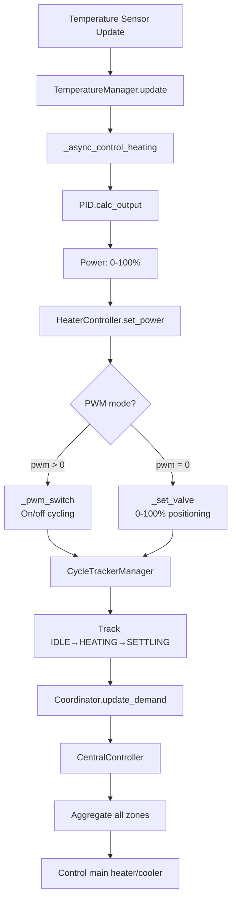
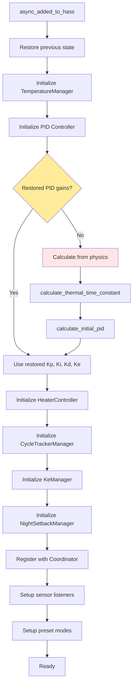

# Development Guide

<!-- pump-aware-fork-preview:start -->
## Fork preview: scheduling architecture and evidence

**Fork preview, not an upstream release feature.** The following information applies to `filou01/ha-adaptive-climate`, branch `codex/pump-aware-pwm`, [preview v0.67.1-pwm.8](https://github.com/filou01/ha-adaptive-climate/releases/tag/v0.67.1-pwm.8). Do not assume the upstream release supports this configuration.

Optional PWM development is isolated on `filou01/ha-adaptive-climate` branch
`codex/pump-aware-pwm`. The domain remains unchanged and no optimizer runtime
dependency is added. HAZoneAdapter binds actual restored entities to a zone
protocol; pure cyclic/executable planners issue no HA services. A group owns
one cancellable next-event timer. Serialized HeaterController actuation,
generation checks after awaits, output confirmation and durable write-ahead
budgets keep execution and observed-time accounting separate from plan proposals.

The [bilingual extension index](https://github.com/filou01/ha-adaptive-climate/blob/codex/pump-aware-pwm/docs/fork-extensions.md#english) links current configuration,
historical source-specific reports and automated/supervised test plans.
The current software was tested on Linux Python 3.11/3.12, with separate
HACS/hassfest checks. Mocked HA boundaries and deterministic daily electrical
replays do not establish physical hydraulic delivery or hardware approval.
Current numbers, exact commits and CI links are in [validation status](https://github.com/filou01/ha-adaptive-climate/blob/codex/pump-aware-pwm/docs/extension-validation.md#english).

Fork preview identity uses explicit prerelease tags; the semantic-release-managed
manifest version remains the upstream baseline. Documentation updates may be
attached to an existing preview release without moving its installed software tag.
<!-- pump-aware-fork-preview:end -->

This guide covers the architecture, testing, and development workflow for the HA Adaptive Climate integration.

## Architecture Overview

### Core Modules

The integration is organized into several core modules:

| Module | Purpose |
|--------|---------|
| `climate.py` | Main entity - orchestrates managers, presets, state |
| `climate_setup.py` | Platform schema, setup, PWM validation |
| `climate_init.py` | Manager initialization factory |
| `coordinator.py` | Zone registry, CentralController, ModeSync, thermal groups |
| `pid_controller/__init__.py` | PID with P, I, D, E (outdoor), F (feedforward) terms |
| `adaptive/learning.py` | Cycle analysis, rule-based PID adjustments |
| `adaptive/validation.py` | ValidationManager for auto-apply safety checks |
| `adaptive/confidence.py` | ConfidenceTracker for convergence confidence |
| `adaptive/learner_serialization.py` | Serialization/deserialization for AdaptiveLearner |
| `adaptive/chronic_approach_detector.py` | Detects persistent inability to reach setpoint |
| `adaptive/cycle_analysis.py` | Cycle metrics calculation and overshoot detection |
| `adaptive/physics.py` | Thermal time constant, Ziegler-Nichols init |
| `adaptive/floor_physics.py` | Floor thermal properties, slab calculations |
| `adaptive/preheat.py` | Predictive pre-heating learner |
| `adaptive/humidity_detector.py` | Humidity-based steam detection |
| `adaptive/undershoot_detector.py` | Undershoot pattern detection |
| `adaptive/contact_sensors.py` | Contact sensor pause/frost protection |
| `adaptive/night_setback.py` | Night setback scheduling |
| `adaptive/thermal_groups.py` | Multi-zone thermal coupling |
| `adaptive/ke_learning.py` | Outdoor compensation learning |
| `sensor.py` | Performance/learning sensors |

### Manager Classes (`managers/`)

The control loop is refactored into specialized manager classes for separation of concerns. Note the naming convention: `*Controller` for hardware-actuating classes, `*Manager` for pure-logic orchestration.

| Manager | Purpose |
|---------|---------|
| `HeaterController` | PWM/valve actuation |
| `PWMController` | Duty accumulation, PWM switching |
| `CycleTrackerManager` | IDLE→HEATING→SETTLING state machine |
| `CycleMetricsRecorder` | Cycle validation, metrics |
| `TemperatureManager` | Temperature tracking |
| `KeManager` | Outdoor compensation |
| `NightSetbackManager` | Night setback orchestration |
| `NightSetbackCalculator` | Preheat timing |
| `PIDGainsManager` | Centralized PID gain mutations, auto-history |
| `SetpointBoostManager` | Setpoint feedforward boost/decay |
| `AutoModeSwitchingManager` | House-wide HVAC mode switching |
| `StatusManager` | Consolidated operational status |

### Naming Conventions

- **Controllers** (`*Controller`): Hardware-actuating classes that directly control physical devices (e.g., `HeaterController`, `PWMController`)
- **Managers** (`*Manager`): Pure-logic orchestration without direct hardware control (e.g., `CycleTrackerManager`, `PIDGainsManager`, `KeManager`, `NightSetbackManager`)

### Code Style Rules

- **Type annotations:** Use `X | None` (PEP 604), not `Optional[X]`
- **Heating types:** Use `HeatingType(StrEnum)` from `const.py` - never raw strings
- **Timestamps:** `homeassistant.util.dt.utcnow()` for wall-clock, `time.monotonic()` for elapsed durations - never `datetime.now()` or `time.time()`
- **Assertions:** Never use `assert` in production code - raise `ValueError`/`TypeError`
- **Entity IDs:** Use `split_entity_id()` - never string slicing
- **HA decorators:** `@callback` only on synchronous functions - never on `async def`
- **Manager interfaces:** Managers receive a `ThermostatState` Protocol, not raw callbacks
- **Coordinator access:** Use `self._coordinator` cached property - never inline `hass.data.get(DOMAIN, {}).get("coordinator")`
- **Persistence:** HA Store API only (`async_save_zone`) - no legacy file-based `save()`

## Data Flow

The following diagram illustrates how temperature updates flow through the system:



## Initialization Flow

The following diagram shows the order in which managers are created and initialized during startup:



## Configuration Architecture

The integration uses a two-level YAML configuration:

### 1. Domain Level (`adaptive_climate:`)

Domain-level configuration includes global settings that apply to all zones:

- `house_energy_rating` - Energy efficiency rating (A-G)
- `main_heater_switch` - Central heating system control entity
- `main_cooler_switch` - Central cooling system control entity
- `source_startup_delay` - Delay before activating main heater (default: 30s)
- `sync_modes` - Enable mode synchronization across zones
- Preset temperatures (away, eco, comfort, etc.)
- Energy/weather sensor entities

### 2. Climate Entity Level (`climate:` - `platform: adaptive_climate`)

Per-zone configuration:

- `heater` - Zone heating device entity
- `cooler` - Zone cooling device entity
- `demand_switch` - Demand tracking entity
- `target_sensor` - Temperature sensor
- `heating_type` - System type (floor_hydronic, radiator, convector, forced_air)
- `area_m2` - Zone area in square meters
- `window_orientation` - Window facing direction
- `night_setback` - Night setback schedule configuration
- `contact_sensors` - Window/door sensors
- `linked_zones` - Thermally coupled zones

### Constants (`const.py`)

- `HeatingType(StrEnum)` - Enum of heating types: `floor_hydronic`, `radiator`, `convector`, `forced_air`
- `HEATING_TYPE_CHARACTERISTICS` - Lookup table with base PID values per heating type
- `PID_LIMITS` - Safety bounds (Kp: 10-500, Ki: 0-100, Kd: 0-200)
- `MIN_CYCLES_FOR_LEARNING` - Requires ≥6 cycles before adaptive recommendations
- Heating type modifiers and PWM defaults (see table in Key Details below)

## Test Organization

Tests are organized by component - run the relevant file when modifying:

### Core Tests

| Test File | Tests |
|-----------|-------|
| `test_pid_controller.py` | PID math |
| `test_physics.py` | Thermal calculations |
| `test_learning.py` | Adaptive tuning rules |
| `test_cycle_tracker.py` | Cycle tracking state machine |
| `test_cycle_analysis.py` | Cycle metrics calculation |
| `test_heater_controller.py` | Heater/PWM control |
| `test_coordinator.py` | Multi-zone coordination |
| `test_central_controller.py` | Main heat source control |
| `test_mode_sync.py` | Mode synchronization |

### Feature Tests

| Test File | Tests |
|-----------|-------|
| `test_night_setback.py` | Night setback scheduling |
| `test_preheat_learner.py` | Predictive pre-heating |
| `test_humidity_detector.py` | Humidity-based steam detection |
| `test_contact_sensors.py` | Contact sensor handling |
| `test_setpoint_boost.py` | Setpoint feedforward |
| `test_chronic_approach_detector.py` | Chronic approach detection |
| `test_auto_mode_switching.py` | Auto mode switching |
| `test_thermal_groups.py` | Thermal coupling |
| `test_ke_learning.py` | Outdoor compensation learning |
| `test_undershoot_detector.py` | Undershoot pattern detection |

### Integration Tests

| Test File | Tests |
|-----------|-------|
| `test_integration_cycle_learning.py` | End-to-end cycle tracking and learning |
| `test_integration_auto_apply.py` | Auto-apply flow |
| `test_integration_control_loop.py` | Control loop integration |
| `test_chronic_approach_integration.py` | Chronic approach integration |
| `test_humidity_integration.py` | Humidity detection integration |

### Manager & Component Tests

| Test File | Tests |
|-----------|-------|
| `test_pid_gains_manager.py` | PID gains management |
| `test_status_manager.py` | Status consolidation |
| `test_climate_init.py` | Manager initialization |
| `test_state_restorer.py` | State restoration |
| `test_state_attributes.py` | State attribute exposure |

## Development Commands

### Running Tests

```bash
# Run all tests
pytest

# Run specific test file
pytest tests/test_pid_controller.py

# Run specific test method
pytest tests/test_physics.py::TestPhysicsCalculations::test_thermal_time_constant

# Run with coverage
pytest --cov=custom_components/adaptive_climate

# Run tests as CI does (verbose, short traceback)
python -m pytest tests/ -v --tb=short
```

### Installation for Development

Copy `custom_components/adaptive_climate/` to Home Assistant's `config/custom_components/`, then restart Home Assistant. No build system - pure Python loaded at runtime.

### Development Dependencies

The project uses pytest for testing. Install dependencies:

```bash
pip install pytest pytest-asyncio pytest-homeassistant-custom-component
```

See `pyproject.toml` for configuration.

## Code Style Guidelines

### File Organization

- **Maximum file length:** 800 lines - extract into modules when exceeded
- **One primary concept per file:** One class, one component, one module
- **Group related files in directories:** By features, domains, or layers (e.g., `managers/`, `adaptive/`)
- **Documentation:** Update GitHub wiki alongside any doc changes

### Code Quality

- **SOLID principles:** Single responsibility, open/closed, Liskov substitution, interface segregation, dependency inversion
- **Meaningful names:** Reveal intent, no abbreviations unless widely known
- **Functions:** Small and do one thing well
- **Comments:** Only when code can't be self-explanatory
- **Consistent formatting:** Match existing codebase style
- **No magic numbers:** Use named constants from `const.py`
- **Fail fast:** Validate inputs early

### Testing

- **Test structure:** Arrange-Act-Assert pattern
- **Edge cases:** Test error conditions and boundary values
- **Fast & isolated:** No external dependencies, deterministic results
- **Meaningful names:** Describe the scenario being tested (e.g., `test_chronic_approach_boosts_ki_after_consecutive_failures`)
- **One assertion per test:** When practical

## Important Caveats

### Service Calls

Always use `hass.services.async_call()` - never directly manipulate entity states.

### PWM vs Valve Control

- **PWM mode** (`pwm > "00:00:00"`): On/off cycling for switches
- **Valve mode** (`pwm: 0` or omitted): Direct 0-100% positioning for valves

### State Persistence

The integration inherits from `RestoreEntity` - PID integral term and gains persist across Home Assistant restarts.

### Outdoor Temperature Compensation (Ke)

Start with 0.3-0.6 for well-insulated buildings. The Ke parameter acts like an integral term with faster response to outdoor temperature changes.

### Integral Clamping

The PID controller uses the formula `I_max = out_max - E` and `I_min = out_min - E` to ensure the total output `P + I + D + E + F` respects the configured bounds. The external term (E) typically contributes <1% of the output range, leaving >99% headroom for the integral term to accumulate.

### Heating Type Characteristics

| Type | PID Mod | PWM Default | Thermal Mass |
|------|---------|-------------|--------------|
| `floor_hydronic` | 0.5x | 15m | Very high |
| `radiator` | 0.7x | 10m | High |
| `convector` | 1.0x | 5m | Medium |
| `forced_air` | 1.3x | 3m | Low |

PID modifiers scale the base gains calculated from physics. PWM defaults are the on/off cycle periods.

## Contributing Guidelines

### Development Workflow

1. **Read before you write** - Understand existing code first
2. **Minimal changes** - Don't refactor what you weren't asked to touch
3. **Match the style** - Follow existing patterns
4. **Test your work** - Run the tests, fix what breaks
5. **Ship it** - Don't get stuck in analysis paralysis

### Pull Request Process

1. Create a feature branch from `main`
2. Write tests for new functionality
3. Ensure all tests pass
4. Update documentation if needed
5. Submit PR with clear description

### Commit Messages

Follow Angular Commit Message Conventions:

- `feat:` new feature
- `fix:` bug fix
- `docs:` documentation changes
- `test:` adding or updating tests
- `refactor:` code restructuring without changing behavior
- `chore:` maintenance tasks, dependencies, config

## Additional Resources

- [Home](https://github.com/afewyards/ha-adaptive-climate/wiki/Home) - Project overview and quick start
- [Configuration](https://github.com/afewyards/ha-adaptive-climate/wiki/Configuration) - Detailed configuration guide
- [PID Control](https://github.com/afewyards/ha-adaptive-climate/wiki/PID-Control) - Understanding PID parameters
- [Adaptive Learning](https://github.com/afewyards/ha-adaptive-climate/wiki/Adaptive-Learning) - How the learning system works

[← Back to Home](https://github.com/afewyards/ha-adaptive-climate/wiki/Home)
