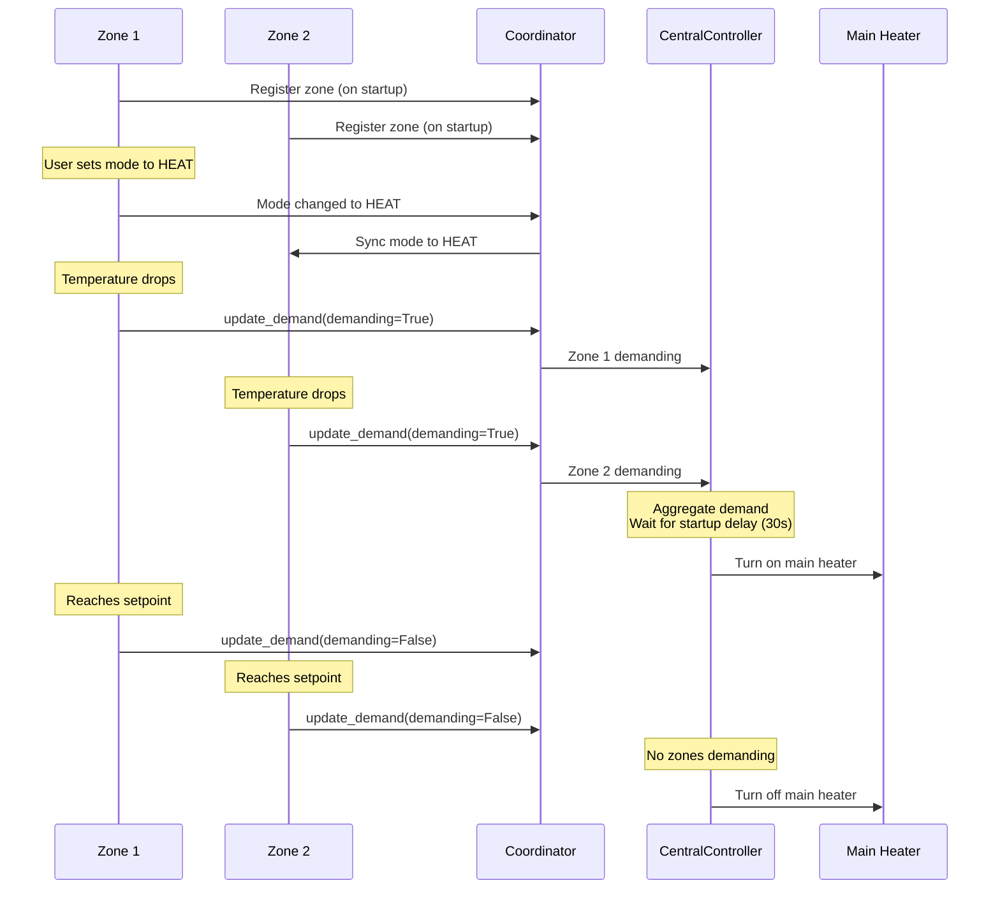

# Multi-Zone Coordination

<!-- pump-aware-fork-preview:start -->
## Optional pump-aware HEAT PWM coordination

**Fork preview, not an upstream release feature.** The following information applies to `filou01/ha-adaptive-climate`, branch `codex/pump-aware-pwm`, [preview v0.67.1-pwm.8](https://github.com/filou01/ha-adaptive-climate/releases/tag/v0.67.1-pwm.8). Do not assume the upstream release supports this configuration.

The fork preview adds phase coordination for genuine heating pulses sharing
one electrically OR-controlled pump. It changes actuator timing, not the
central heat-source controller, physical pump RPM or hydraulic flow. It is
disabled by default and does not silently coordinate unconfigured zones.

- `minimal`: reduce avoidable group starts first; then prefer short genuine
  handovers and solo time for the highest-weight zone. Longer energized pump
  time is accepted. Necessary long overlaps favor smaller zones.
- `maximal`: concentrate ordinary pulse starts and requested ON time. This can
  reduce energized time but increase starts compared with a continuous workload.
- Genuine effective target changes and OFF-to-HEAT are evaluated immediately,
  subject to existing demand/credit and minimum-time protection. Ordinary PID
  ticks do not gain priority. No heat may be invented to fill a pump gap.

Preview 8 repairs executable minimal handovers using signed remaining budgets,
committed ON time, minimum-OFF bounds, original deadlines and advisory next
budget opportunities. Active/priority starts stay fixed, one ordinary start
per zone/epoch remains enforced and future forecasts never authorize ON.
Actual eligibility and output state are rechecked through HeaterController.

See [Fork Extensions](Fork-Extensions.md), the [configuration guide](https://github.com/filou01/ha-adaptive-climate/blob/codex/pump-aware-pwm/docs/pump-aware-pwm.md#english)
and [current handover test plan](https://github.com/filou01/ha-adaptive-climate/blob/codex/pump-aware-pwm/docs/pwm-runtime-handovers.md#english). A target electrical overlap
is not proof of open valves, minimum flow or physical pump continuity.
<!-- pump-aware-fork-preview:end -->

Adaptive Climate provides sophisticated coordination between multiple zones to optimize comfort and efficiency in multi-zone heating/cooling systems. The coordination system consists of six key components: central heat source control, mode synchronization, zone demand tracking, thermal coupling, manifold transport delay tracking, and automatic mode switching.

## Architecture

Multi-zone coordination is implemented through several components:

| Component | Module | Purpose |
|-----------|--------|---------|
| `AdaptiveThermostatCoordinator` | `coordinator.py` | Central registry - tracks all zones, provides zone data, outdoor temp, demand aggregation |
| `CentralController` | `central_controller.py` | Aggregates zone demand and controls the main heat source (boiler/heat pump/chiller) |
| `ModeSync` | `coordinator.py` | Synchronizes HEAT/COOL mode changes across all zones |
| `ThermalGroupManager` | `adaptive/thermal_groups.py` | Static thermal groups with leader/follower coordination and cross-group heat transfer |
| `ManifoldRegistry` | `adaptive/manifold_registry.py` | Tracks hydraulic manifolds and calculates transport delays for hydronic systems |
| `AutoModeSwitchingManager` | `managers/auto_mode_switching.py` | House-wide automatic HEAT/COOL mode switching based on outdoor temp and forecast |

### Coordination Flow



## Central Heat Source Control

The `CentralController` aggregates demand from all zones to control the main boiler, heat pump, or chiller. This is essential for systems where multiple zones share a single heat source.

### How It Works

1. **Demand Aggregation** - Central controller monitors demand switches from all zones
2. **Startup Delay** - Waits for valves to open before firing the heat source (default 30 seconds)
3. **Debounced Shutoff** - Waits 10 seconds after demand stops before turning off (prevents flickering during restarts)
4. **Independent Heating/Cooling** - Heater and cooler controlled independently based on respective demand
5. **Multi-Device Support** - Can control multiple switches (e.g., boiler + circulation pump)
6. **Retry Logic** - Automatic retry with exponential backoff on service call failures

### Configuration

```yaml
adaptive_climate:
  # Single heat source
  main_heater_switch: switch.boiler

  # Or multiple devices
  main_heater_switch:
    - switch.boiler
    - switch.circulation_pump

  # Cooling support
  main_cooler_switch:
    - switch.ac_compressor

  # Startup delay (seconds) - allows valves to open first
  source_startup_delay: 30
```

**Configuration Parameters:**

| Parameter | Default | Description |
|-----------|---------|-------------|
| `main_heater_switch` | - | Main heater switch(es) - single entity or list |
| `main_cooler_switch` | - | Main cooler switch(es) - single entity or list |
| `source_startup_delay` | 30 | Seconds to wait before activating heat source |

### Benefits

- **Efficiency** - Heat source only runs when zones need it
- **Equipment Protection** - Startup delay prevents dry-firing or pump cavitation
- **Centralized Control** - Single point of control for the entire heating/cooling system
- **Flexible** - Supports single or multiple control devices

## Mode Synchronization

The `ModeSync` component ensures all zones operate in compatible modes, preventing conflicts like one zone calling for heat while another calls for cooling.

### Synchronization Rules

- **HEAT/COOL propagates** - When any zone switches to HEAT or COOL, all other non-OFF zones sync to that mode
- **OFF stays independent** - Zones can be turned OFF individually without affecting others
- **Sync can be disabled per zone** - Individual zones can opt out of mode synchronization if needed
- **Feedback loop prevention** - Built-in guard prevents infinite sync loops during concurrent changes

### Configuration

```yaml
adaptive_climate:
  sync_modes: true  # Default: true
```

### Example Scenarios

**Scenario 1: User changes zone to HEAT**
1. User sets Living Room to HEAT mode
2. ModeSync propagates HEAT to Kitchen, Bedroom, Bathroom
3. All zones now operate in HEAT mode

**Scenario 2: User turns off zone**
1. User sets Bedroom to OFF mode
2. ModeSync does not propagate OFF
3. Other zones continue in current mode (e.g., HEAT)

**Scenario 3: Automatic mode change**
1. Living Room switches from HEAT to AUTO
2. ModeSync allows compatible transition
3. Other zones remain in HEAT (compatible with AUTO)

### Benefits

- **Prevents Conflicts** - No simultaneous heating and cooling
- **Simplifies Control** - One mode change affects all zones
- **Respects Independence** - Zones can be turned off individually

## Zone Demand Tracking

Each zone automatically creates a demand switch (`switch.{zone}_demand`) that indicates when the zone is actively calling for heating or cooling.

### Demand Switch Behavior

- **ON** when PID output exceeds the demand threshold (typically 30-40%)
- **OFF** when PID output falls below threshold
- **Used internally** by CentralController to aggregate demand
- **Available for automations** - expose in UI or use in custom logic

### Example Use Cases

**1. Central controller integration:**
```yaml
# Automatic - no configuration needed
# Central controller monitors all demand switches
```

**2. Custom automation:**
```yaml
automation:
  - alias: Alert on high heating demand
    trigger:
      - platform: numeric_state
        entity_id:
          - switch.living_room_demand
          - switch.kitchen_demand
          - switch.bedroom_demand
        above: 2  # More than 2 zones demanding
    action:
      - service: notify.mobile_app
        data:
          message: "Multiple zones demanding heat - check system"
```

**3. Dashboard visualization:**
```yaml
type: entities
entities:
  - entity: switch.living_room_demand
    name: Living Room Heating Demand
  - entity: switch.kitchen_demand
    name: Kitchen Heating Demand
  - entity: switch.bedroom_demand
    name: Bedroom Heating Demand
```

### Benefits

- **Transparency** - Clear visibility into which zones need heating/cooling
- **Automation Support** - Use in custom automations and scripts
- **Central Coordination** - Enables intelligent main heat source control

## Thermal Groups

The thermal groups system provides declarative configuration for zones with thermal relationships, such as open plan areas and cross-floor heat transfer. Unlike learning-based systems, thermal groups use static configuration with feedforward compensation based on configured transfer factors.

### How It Works

1. **Leader/Follower Coordination** - In open plan areas, follower zones track the leader zone's setpoint
2. **Cross-Group Heat Transfer** - Groups can receive heat from other groups with configurable delay
3. **Feedforward Compensation** - Historical heat output from source groups reduces PID output in receiving zones
4. **Transfer History** - System tracks last 2 hours of heat output for delayed feedforward calculations

### Group Types

**Open Plan Groups:**
- One leader zone sets the setpoint
- Follower zones track the leader's setpoint
- Coordinated heating in shared spaces (e.g., living/dining/kitchen)

**Cross-Group Transfer:**
- Heat from one group affects another (e.g., downstairs heat rises to upstairs)
- Configurable transfer factor (0.0-1.0) and delay (minutes)
- Feedforward compensation prevents overshoot in receiving zones

### Configuration

Configure thermal groups at domain level:

```yaml
adaptive_climate:
  thermal_groups:
    # Open plan group (leader/follower coordination)
    - name: "Open Plan Living"
      type: "open_plan"
      leader: climate.living_room
      zones:
        - climate.living_room
        - climate.kitchen
        - climate.dining_room

    # Group receiving heat from another group
    - name: "Upstairs Bedrooms"
      type: "open_plan"
      leader: climate.master_bedroom
      zones:
        - climate.master_bedroom
        - climate.bedroom_2
      receives_from: "Open Plan Living"
      transfer_factor: 0.3        # 30% of downstairs heat rises
      delay_minutes: 15           # 15 min delay for heat to propagate
```

**Configuration Parameters:**

| Parameter | Required | Description |
|-----------|----------|-------------|
| `name` | Yes | Unique identifier for the group |
| `type` | No | Group type (default: "open_plan") |
| `zones` | Yes | List of zone entity IDs in this group |
| `leader` | Yes (for open_plan) | Leader zone entity ID |
| `receives_from` | No | Source group name for heat transfer |
| `transfer_factor` | No | Fraction of source heat (0.0-1.0, requires receives_from) |
| `delay_minutes` | No | Time delay for heat transfer (requires receives_from) |

### Use Cases

**Open Floor Plan:**
```yaml
adaptive_climate:
  thermal_groups:
    - name: "Downstairs"
      type: "open_plan"
      leader: climate.living_room
      zones:
        - climate.living_room
        - climate.kitchen
        - climate.dining_room
```
Result: Kitchen and dining room track living room's setpoint, coordinated heating.

**Multi-Story Heat Transfer:**
```yaml
adaptive_climate:
  thermal_groups:
    - name: "Ground Floor"
      type: "open_plan"
      leader: climate.living_room
      zones:
        - climate.living_room
        - climate.kitchen

    - name: "First Floor"
      type: "open_plan"
      leader: climate.master_bedroom
      zones:
        - climate.master_bedroom
        - climate.bedroom_2
      receives_from: "Ground Floor"
      transfer_factor: 0.25       # 25% of ground floor heat rises
      delay_minutes: 20           # 20 min propagation delay
```
Result: Upstairs zones reduce heating output when downstairs is heating (feedforward compensation).

### Feedforward Calculation

When a receiving group has a configured `receives_from` relationship:

1. System records heat output history from source group zones
2. After delay period, applies transfer factor to historical heat output
3. Reduces PID output in receiving zones by calculated feedforward amount
4. Prevents overshoot from anticipated heat transfer

**Example:**
- Downstairs living room heating at 60% output
- Transfer factor: 0.3, delay: 15 minutes
- After 15 minutes, upstairs PID output reduced by 60% × 0.3 = 18%

### Benefits

- **Simple Configuration** - Declarative YAML, no learning required
- **Leader/Follower Coordination** - Synchronized setpoints in open plan areas
- **Cross-Floor Compensation** - Feedforward prevents overshoot from rising heat
- **Configurable Delay** - Models realistic heat propagation time
- **Energy Savings** - Reduces redundant heating in thermally coupled spaces

## Manifold Transport Delay

For hydronic heating systems with multiple manifolds, the `ManifoldRegistry` tracks transport delays for hot water to reach zones. When a manifold has been inactive (no zones heating) for more than 5 minutes, the water in the pipes cools. The first heating cycle must fill the manifold with hot water before zones receive heat.

### How It Works

1. **Transport Delay Calculation** - `delay = pipe_volume / (active_loops × flow_per_loop)`
2. **Cooldown Tracking** - Manifolds inactive for >5 minutes are considered "cold"
3. **Active Tracking** - When any zone on a manifold starts heating, manifold is marked as "warm"
4. **Zero Delay When Warm** - Active manifolds (within 5 min) have no transport delay

### Configuration

```yaml
adaptive_climate:
  manifolds:
    - name: "Ground Floor"
      zones:
        - climate.living_room
        - climate.kitchen
        - climate.dining_room
      pipe_volume: 8.0           # Liters from boiler to manifold
      flow_per_loop: 2.0          # L/min per loop (default: 2.0)

    - name: "First Floor"
      zones:
        - climate.master_bedroom
        - climate.bedroom_2
      pipe_volume: 12.0           # Longer pipe run upstairs
      flow_per_loop: 2.0
```

**Configuration Parameters:**

| Parameter | Required | Description |
|-----------|----------|-------------|
| `name` | Yes | Unique identifier for the manifold |
| `zones` | Yes | List of zone entity IDs served by this manifold |
| `pipe_volume` | Yes | Total pipe volume in liters from heat source to manifold |
| `flow_per_loop` | No | Flow rate per loop in L/min (default: 2.0) |

### Example Calculation

**Scenario:** Ground floor manifold with 8L pipe volume
- Living room has 2 loops, kitchen has 2 loops, dining room has 1 loop
- Living room calls for heat (manifold has been off for 30 minutes)
- Active loops = 2 (living room only)
- Transport delay = 8.0L / (2 loops × 2.0 L/min/loop) = 2.0 minutes

The PID controller will account for this 2-minute delay when calculating heating control, preventing overshoot from delayed heat delivery.

### Integration with Preheat

Manifold transport delay is included in preheat calculations. When scheduling night setback recovery, the system uses the worst-case transport delay (all zones on one manifold inactive) to ensure the zone reaches target temperature at the scheduled time.

### Benefits

- **Accurate Control** - PID accounts for transport delay, preventing overshoot
- **Realistic Modeling** - Matches physical behavior of hydronic systems
- **Preheat Coordination** - Ensures on-time recovery from night setback
- **Multi-Manifold Support** - Each manifold tracked independently

## Auto Mode Switching

The auto mode switching feature automatically switches all zones between HEAT and COOL modes based on outdoor temperature relative to zone setpoints, with seasonal locking and forecast lookahead for proactive switching.

### How It Works

1. **Outdoor Temperature Comparison** - Compares outdoor temp to median setpoint of all active zones
2. **Hysteresis Logic** - Uses configurable threshold (default 2°C) to prevent oscillation
3. **Forecast Lookahead** - Checks forecast for next N hours to proactively switch modes
4. **Season Locking** - Prevents inappropriate mode changes based on forecast median temperature
5. **House-Wide Propagation** - Applies mode to all non-OFF zones via ModeSync

### Configuration

```yaml
adaptive_climate:
  # Required: Weather entity for outdoor temp and forecast
  weather_entity: weather.home

  # Auto mode switching configuration
  auto_mode_switching:
    enabled: true                  # Enable automatic mode switching
    threshold: 2.0                 # °C delta from median setpoint (default: 2.0)
    min_switch_interval: 3600      # Seconds between switches (default: 3600)
    forecast_hours: 6              # Lookahead hours for forecast (default: 6)
    season_thresholds:
      winter_below: 12.0           # Forecast median < this = winter (HEAT only)
      summer_above: 18.0           # Forecast median > this = summer (COOL only)
```

**Configuration Parameters:**

| Parameter | Default | Description |
|-----------|---------|-------------|
| `enabled` | false | Enable automatic mode switching |
| `threshold` | 2.0 | Temperature delta (°C) from median setpoint for mode change |
| `min_switch_interval` | 3600 | Minimum seconds between mode switches |
| `forecast_hours` | 6 | Number of forecast hours to check for proactive switching |
| `season_thresholds.winter_below` | 12.0 | Forecast median below this = winter (HEAT only) |
| `season_thresholds.summer_above` | 18.0 | Forecast median above this = summer (COOL only) |

### Decision Logic

**Mode Selection:**
- `outdoor_temp < median_setpoint - threshold` → HEAT
- `outdoor_temp > median_setpoint + threshold` → COOL
- In between (hysteresis zone) → check forecast for proactive switching, otherwise keep current mode

**Season Locking:**
- **Winter** (forecast median < 12°C) → only HEAT allowed, blocks switch to COOL
- **Summer** (forecast median > 18°C) → only COOL allowed, blocks switch to HEAT
- **Shoulder** (12-18°C) → both HEAT and COOL allowed

**Forecast Override:**
When outdoor temp is in the hysteresis zone, the system checks the forecast for the next `forecast_hours`. If forecast temperatures cross the threshold, the system proactively switches mode before outdoor temp actually crosses.

### Example Scenarios

**Scenario 1: Spring morning (outdoor 10°C, median setpoint 20°C)**
- 10°C < 20°C - 2°C → Switch to HEAT
- Forecast median = 15°C → shoulder season (both modes allowed)
- All non-OFF zones switch to HEAT mode

**Scenario 2: Summer day (outdoor 28°C, median setpoint 22°C)**
- 28°C > 22°C + 2°C → Switch to COOL
- Forecast median = 25°C → summer season (COOL only)
- All non-OFF zones switch to COOL mode

**Scenario 3: Shoulder season (outdoor 16°C, median setpoint 18°C)**
- 16°C in hysteresis zone (18°C ± 2°C)
- Check forecast: next 6 hours show temps rising to 23°C
- 23°C > 18°C + 2°C → Proactive switch to COOL
- All non-OFF zones switch to COOL mode

**Scenario 4: Winter protection (outdoor 14°C, forecast median 10°C)**
- Forecast median = 10°C → winter season
- Even if outdoor temp rises above threshold, COOL mode is blocked
- System stays in HEAT mode

### Debug Attributes

When `debug: true` is enabled in domain config, additional attributes are exposed:

```yaml
auto_mode_switching_enabled: true
auto_mode_switching:
  current_season: shoulder
  forecast_median_temp: 15.5
  median_setpoint: 20.0
  last_switch: "2024-01-15T10:30:00+00:00"
  next_allowed_switch: "2024-01-15T11:30:00+00:00"
```

### Benefits

- **Automatic Comfort** - No manual mode switching needed when weather changes
- **Proactive Switching** - Forecast lookahead switches before conditions become uncomfortable
- **Energy Savings** - Prevents heating/cooling when outdoor temp makes it unnecessary
- **Season Protection** - Prevents inappropriate mode changes (e.g., cooling in winter)
- **Centralized Control** - One decision point for entire house

## Complete Multi-Zone Example

Here's a complete configuration for a two-story house with shared heat source, hydronic heating with manifolds, open plan downstairs, and cross-floor heat transfer:

```yaml
adaptive_climate:
  # Central heat source (all zones share this boiler)
  main_heater_switch:
    - switch.boiler
    - switch.circulation_pump
  source_startup_delay: 30

  # Sync modes across all zones
  sync_modes: true

  # Shared settings
  house_energy_rating: C

  # Weather entity for outdoor compensation and auto mode switching
  weather_entity: weather.home

  # Auto mode switching (optional)
  auto_mode_switching:
    enabled: true
    threshold: 2.0
    min_switch_interval: 3600
    forecast_hours: 6
    season_thresholds:
      winter_below: 12.0
      summer_above: 18.0

  # Manifold transport delay (for hydronic systems)
  manifolds:
    - name: "Ground Floor"
      zones:
        - climate.living_room
        - climate.kitchen
        - climate.dining_room
      pipe_volume: 8.0
      flow_per_loop: 2.0
    - name: "First Floor"
      zones:
        - climate.master_bedroom
        - climate.bedroom_2
      pipe_volume: 12.0
      flow_per_loop: 2.0

  # Thermal groups - static leader/follower coordination
  thermal_groups:
    - name: "Downstairs Open Plan"
      type: "open_plan"
      leader: climate.living_room
      zones:
        - climate.living_room
        - climate.kitchen
        - climate.dining_room

    - name: "Upstairs Bedrooms"
      type: "open_plan"
      leader: climate.master_bedroom
      zones:
        - climate.master_bedroom
        - climate.bedroom_2
      receives_from: "Downstairs Open Plan"
      transfer_factor: 0.25
      delay_minutes: 20

climate:
  # Downstairs open floor plan
  - platform: adaptive_climate
    name: Living Room
    heater: switch.living_room_valve
    target_sensor: sensor.living_room_temperature
    heating_type: radiator
    area_m2: 25

  - platform: adaptive_climate
    name: Kitchen
    heater: switch.kitchen_valve
    target_sensor: sensor.kitchen_temperature
    heating_type: radiator
    area_m2: 18

  - platform: adaptive_climate
    name: Dining Room
    heater: switch.dining_room_valve
    target_sensor: sensor.dining_room_temperature
    heating_type: radiator
    area_m2: 16

  # Upstairs bedrooms
  - platform: adaptive_climate
    name: Master Bedroom
    heater: switch.master_bedroom_valve
    target_sensor: sensor.master_bedroom_temperature
    heating_type: radiator
    area_m2: 20

  - platform: adaptive_climate
    name: Bedroom 2
    heater: switch.bedroom_2_valve
    target_sensor: sensor.bedroom_2_temperature
    heating_type: radiator
    area_m2: 14
```

### How This Configuration Works

1. **Central Control** - All zones share the boiler and circulation pump
2. **Mode Sync** - Changing any zone to HEAT or COOL propagates to all non-OFF zones
3. **Auto Mode Switching** - System automatically switches between HEAT/COOL based on outdoor temp and forecast
4. **Startup Delay** - 30 second delay allows valves to open before boiler fires
5. **Manifold Transport Delay** - Two manifolds (ground floor 8L, first floor 12L) track transport delays
6. **Thermal Groups** - Two groups: downstairs open plan (leader: living room) and upstairs bedrooms (leader: master bedroom)
7. **Leader/Follower** - Kitchen and dining room track living room setpoint; bedroom 2 tracks master bedroom
8. **Cross-Floor Transfer** - Upstairs receives 25% of downstairs heat with 20 min delay, reducing upstairs heating via feedforward

## Troubleshooting

### Main heat source not turning on
- Check that at least one zone has `demanding=True` (check demand switches)
- Verify `source_startup_delay` isn't too long
- Ensure `main_heater_switch` entity IDs are correct
- Check Home Assistant logs for errors

### Zones not synchronizing modes
- Verify `sync_modes: true` in adaptive_climate config
- Check that zones are properly registered with coordinator
- Review Home Assistant logs for ModeSync errors

### Thermal groups not working
- Verify zones are listed in thermal_groups configuration
- Check that leader zone entity ID is correct and in zones list
- Ensure follower zones are in the same group as leader
- Review logs for thermal group validation errors on startup

### Follower zones not tracking leader setpoint
- Verify group type is "open_plan"
- Check that leader is correctly specified
- Ensure zones are properly assigned to the group
- Check climate entity logs for setpoint changes

### Cross-group feedforward not compensating
- Verify receives_from group name matches source group exactly
- Check that transfer_factor is set (0.0-1.0)
- Ensure source group zones are actually heating
- Verify delay_minutes allows enough time for history to build
- Check logs for feedforward calculations

### Demand switches not updating
- Verify PID output exceeds demand threshold (check climate entity attributes)
- Check that heater/cooler is configured and functional
- Review demand switch state in Developer Tools

### Auto mode switching not working
- Verify `weather_entity` is configured and available
- Check that `enabled: true` in auto_mode_switching config
- Ensure at least one zone is not in OFF mode (need active setpoints)
- Verify outdoor temperature is available from weather entity
- Check `min_switch_interval` hasn't prevented recent switch
- Review logs for auto mode switching debug messages

### Auto mode switching incorrect
- Check `threshold` value - may need adjustment for your climate
- Review season thresholds (`winter_below`, `summer_above`)
- Verify forecast data is available and accurate
- Check median setpoint calculation (all active zones)
- Enable debug mode to see `auto_mode_switching` attributes

---

[← Back to Home](https://github.com/afewyards/ha-adaptive-climate/wiki/Home) | [Energy Optimization →](https://github.com/afewyards/ha-adaptive-climate/wiki/Energy-Optimization)
